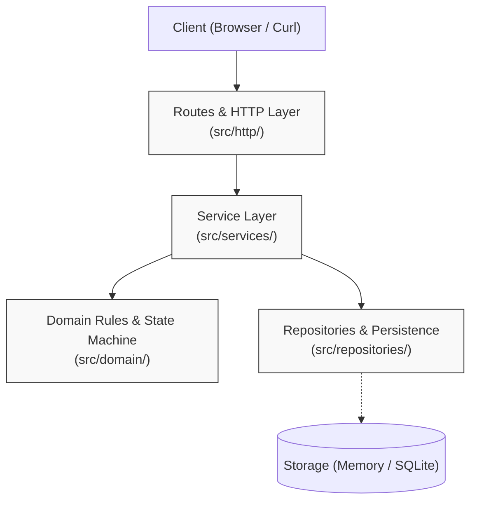
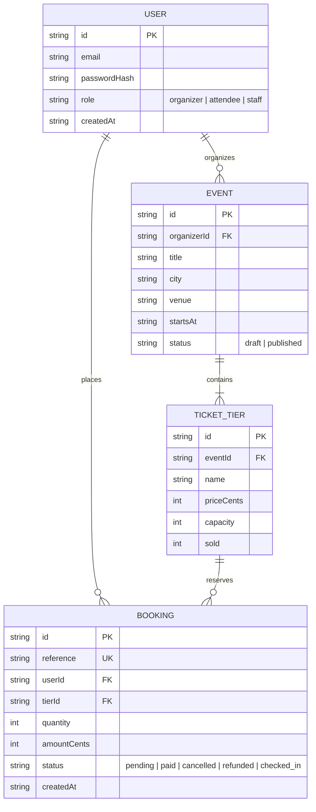
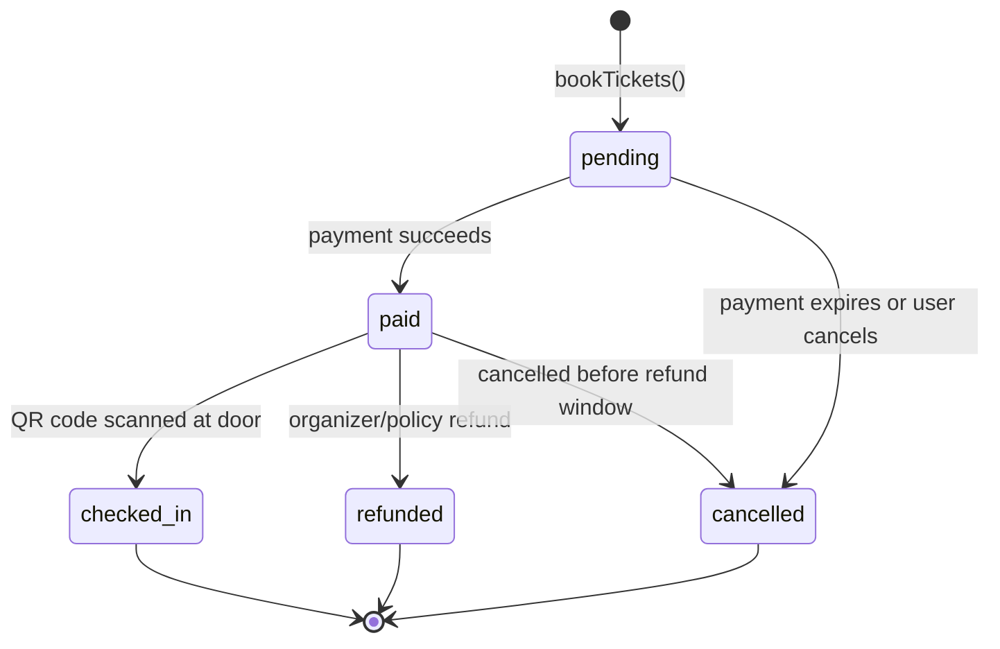

# System Architecture & Design

This document details the layered architecture, data model, and booking life cycle for the Event Ticketing platform.

---

## 1. Layered Architecture

Dependencies flow in one direction only. Upper layers call lower layers; lower layers never call upwards.

### Layer Responsibilities and Boundaries

- **Routes & HTTP Layer (`src/http/`):** Parses HTTP requests, extracts parameters, handles content negotiation, calls services, and serializes responses; it may **not** contain business logic or query databases directly.
- **Service Layer (`src/services/`):** Orchestrates application use cases, transactions, and authorization by coordinating domain entities and repositories; it may **not** deal with HTTP transport details like status codes or headers.
- **Domain Layer (`src/domain/`):** Encapsulates pure business rules, entity models, calculations (pricing, capacities), and state transitions; it may **not** perform I/O, make network requests, or depend on databases.
- **Repository Layer (`src/repositories/`):** Manages data retrieval and persistence across storage mechanisms (in-memory Maps or SQLite); it may **not** enforce business rules or make domain decisions.

---

## 2. Data Model

---

## 3. Booking Life Cycle (State Machine)

A booking moves through a strict set of states. Terminal states can never transition to any other state.

### Transition Table

| Current State | Allowed Next States | Trigger |
| :--- | :--- | :--- |
| `pending` | `paid`, `cancelled` | Payment completed, or user cancels / reservation expires |
| `paid` | `checked_in`, `refunded`, `cancelled` | QR check-in at venue, refund processed, or cancellation |
| `cancelled` | *(none - terminal)* | Seats are released; cannot transition |
| `refunded` | *(none - terminal)* | Money returned, seats released; cannot transition |
| `checked_in` | *(none - terminal)* | Attendee entered event; ticket is consumed |
